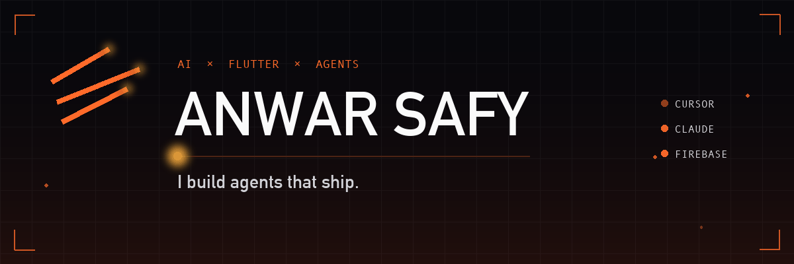

<div align="center">




**Anwar Safy** turns any idea into something real. A product that exists and people can open.

</div>

## Open source

The pieces I got tired of rewriting.

| Package | What it does |
| --- | --- |
| **[Flutter Firebase Starter](https://github.com/anwarsafy/starter)** | Production starter. Email, Google, Apple, and phone auth, FCM, Firestore profiles, route guards, English and Arabic. |
| **[dynamic_form_fields](https://pub.dev/packages/dynamic_form_fields)** | Drag-and-drop form builder with validation. |
| **[http_api_handler](https://pub.dev/packages/http_api_handler)** | HTTP client with logging, errors, auth tokens, and file transfer. |
| **[firebase_excel_export](https://pub.dev/packages/firebase_excel_export)** | Firestore collections to Excel, for Flutter web. |
| **[xdialog](https://pub.dev/packages/xdialog)** | Animated dialogs with more than one action. |

## The agent skill

After the products, I wrote the rules down so a coding agent holds the same bar.

**[flutter-firebase-bloc-skill](https://github.com/anwarsafy/flutter-firebase-bloc-skill)** is for Cursor, Claude Code, Copilot, Windsurf, and 35+ other tools. Clean Architecture, single-state BLoC, offline-first Firestore, hardened rules, flavors, and CI. The map is the **[live blueprint](https://anwarsafy.github.io/flutter-firebase-bloc-skill/)**.

```bash
npx skills add anwarsafy/flutter-firebase-bloc-skill
```

<div align="center">

[](https://github.com/anwarsafy/flutter-firebase-bloc-skill)
[](https://anwarsafy.github.io/flutter-firebase-bloc-skill/)
[](https://github.com/anwarsafy/flutter-firebase-bloc-skill/actions)

</div>

## Stack

<div align="center">


</div>

## This year

<div align="center">


</div>

## Reach me

A product from the first screen through the admin panel.

**[anwr@olu-it.com](mailto:anwr@olu-it.com)** · **[LinkedIn](https://www.linkedin.com/in/anwar-safy-81243521a)** · **[Medium](https://medium.com/@anwarsafy15)**


